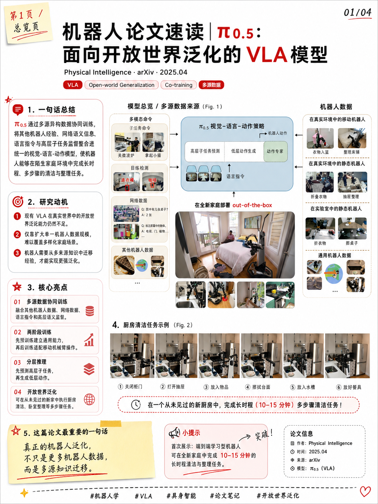
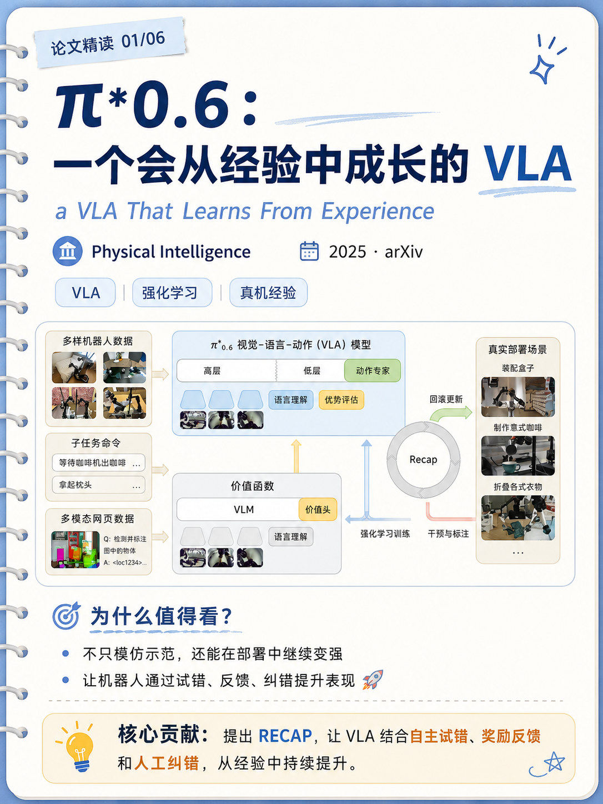
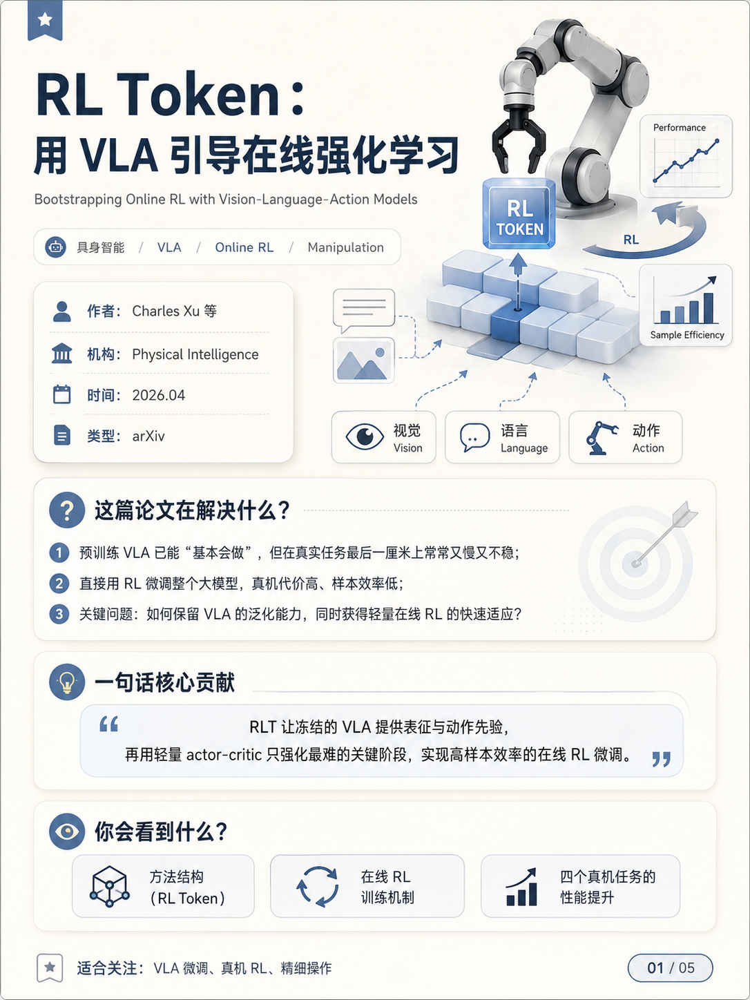
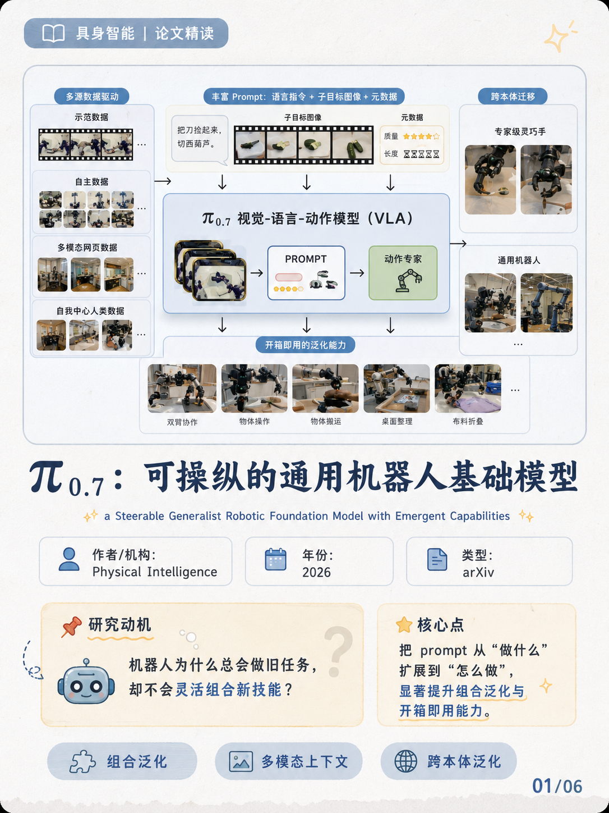
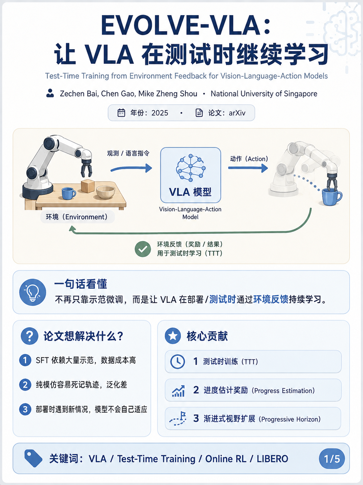
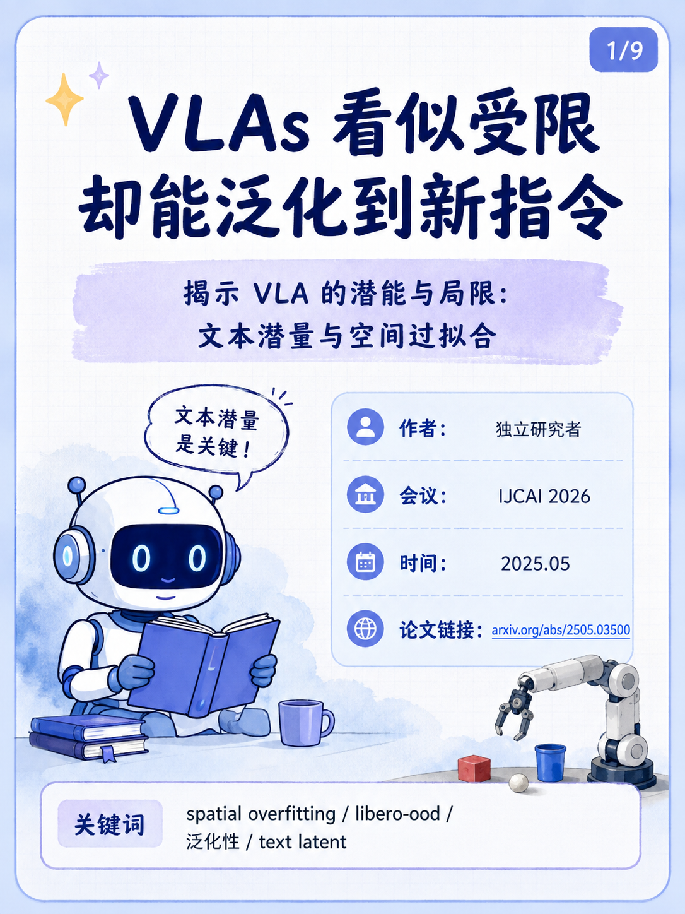
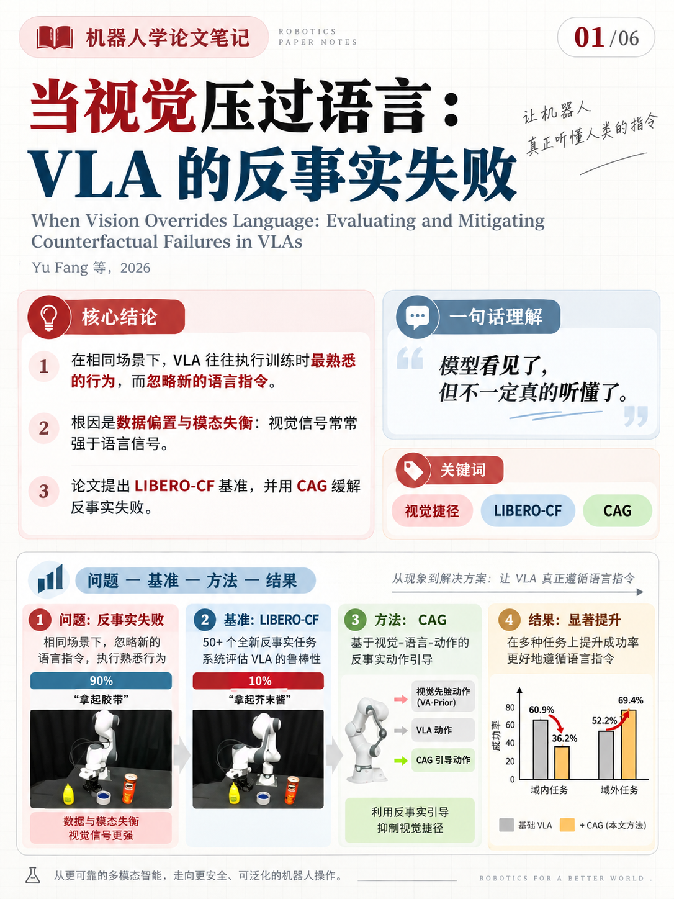
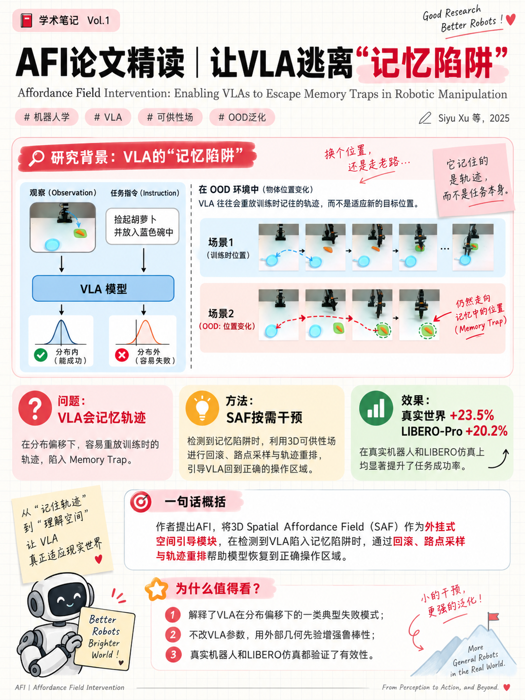
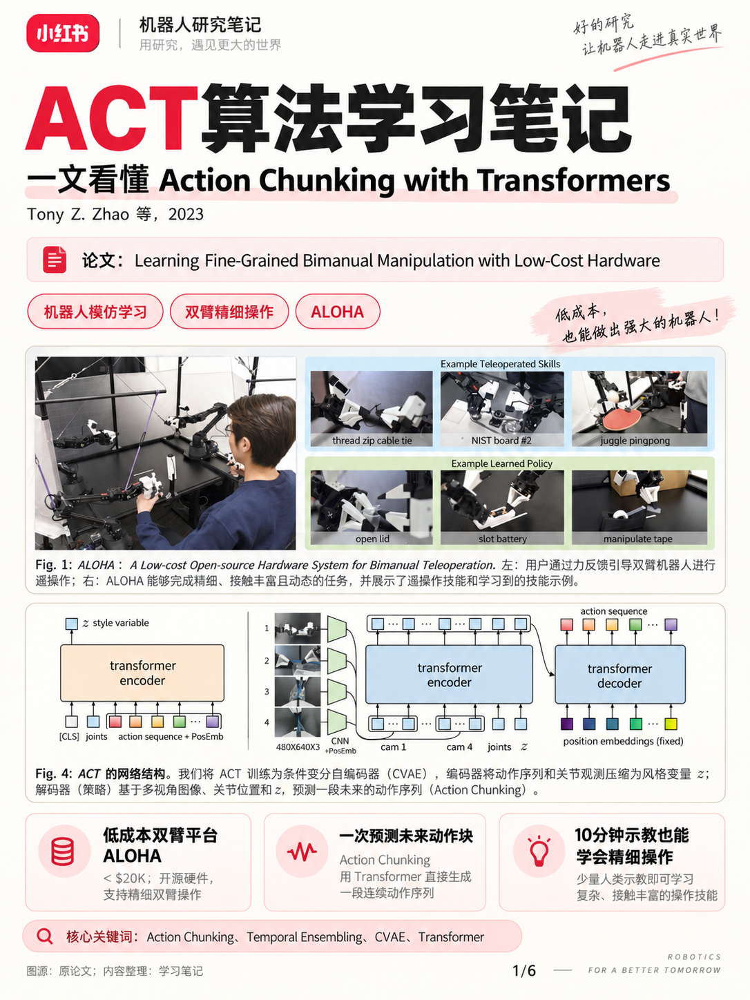

# VLA Learning Path

> 💡 **Vision-Language-Action（VLA）个人学习路线记录：精选重要工作，并用简短总结与 Poster笔记 梳理学习脉络。**

### 🎯 收录原则

VLA 领域工作众多，本仓库不追求完整收录，仅记录具有代表性、里程碑意义，或对技术路线有重要影响的工作。

本仓库不提供逐篇文字笔记。每篇论文仅保留一份由个人阅读笔记提炼而成的**总结 PDF**，用于快速回顾核心方法、模型结构与实验结论。

## 分类方式

表中的类别按照 VLA 领域两条主要技术分支组织：

| 类别 | 生成方式 |
| --- | --- |
| **Autoregressive** | 以自回归 VLA 为主线 |
| **Diffusion/Flow-based** | 通过去噪或流匹配生成动作，可直接建模连续、多峰的动作分布 |

## 学习路线

| # | 分类 | 论文 | 时间 | TL;DR | 阅读总结 |
| :---: | :---: | --- | :---: | --- | :---: |
| 1 | Autoregressive | [OpenVLA: An Open-Source Vision-Language-Action Model](https://arxiv.org/abs/2406.09246) | 2024.06 | 开源的 7B VLA，在 97 万条真实机器人轨迹上训练，将视觉、语言与离散动作 token 统一到自回归生成框架中。 | 待整理 |
| 2 | Autoregressive | [OpenVLA-OFT: Fine-Tuning Vision-Language-Action Models: Optimizing Speed and Success](https://arxiv.org/abs/2502.19645) | 2025.02 | 提出 OFT 微调方案，以并行解码、动作分块、连续动作表示和 L1 回归显著提升 OpenVLA 的推理速度与任务成功率。 | 待整理 |
| 3 | -- | [LIBERO: Benchmarking Knowledge Transfer for Lifelong Robot Learning](https://arxiv.org/abs/2306.03310) | 2023.06 | 面向机器人终身学习与知识迁移的基准，提供 4 个任务套件、共 130 个任务及配套的人类遥操作演示数据。 | 待整理 |
| 4 | Diffusion/Flow-based | [$\pi_{0}$: A Vision-Language-Action Flow Model for General Robot Control](https://arxiv.org/abs/2410.24164) | 2024.10 | 在预训练 VLM 上引入 Flow Matching 动作专家，并利用跨机器人平台的大规模数据训练通用机器人策略。 | 待整理 |
| 5 | Diffusion/Flow-based | [$\pi_{0.5}$: a Vision-Language-Action Model with Open-World Generalization](https://arxiv.org/abs/2504.16054) | 2025.04 | 在 $\pi_{0}$ 之上引入异构数据协同训练与高层语义子任务预测，使机器人能在未见过的家庭环境中完成长时程、灵巧操作。 |  |
| 6 | Diffusion/Flow-based | [$π^{*}_{0.6}$: a VLA That Learns From Experience](https://arxiv.org/abs/2511.14759) | 2025.11 | 引入价值网络，提出RECAP迭代式离线强化学习框架，利用demonstration、部署后rollout数据、人类干预数据迭代变强 |  |
| 7 | -- | [State of VLA Research at ICLR 2026](https://mbreuss.github.io/blog_post_iclr_26_vla.html) | 2025.10 | 基于ICLR 2025的提交论文，梳理VLA研究现状（定义、研究热点、benchmark等） |   |
| 8 | Diffusion/Flow-based | [RL Token: Bootstrapping Online RL with Vision-Language-Action Models](https://arxiv.org/abs/2604.23073) | 2026.04 | 引入RL token，利用VLA表征和任务的基础完成能力，结合轻量Actor-Critic进行在线学习，提高任务成功率和执行速度 |   |
| 9 | Diffusion/Flow-based | [$π_{0.7}$: a Steerable Generalist Robotic Foundation Model with Emergent Capabilities](https://arxiv.org/abs/2604.15483) | 2026.04 | π0.7 通过向模型提供包含子任务指令、子目标图像及回合元数据的多样化提示，使其能从质量参差的海量数据中学习并获得跨本体与组合泛化的能力 |   |
| 10 | Autoregressive | [EVOLVE-VLA: Test-Time Training from Environment Feedback for Vision-Language-Action Models](https://arxiv.org/abs/2512.14666) | 2025.12 | EVOLVE-VLA 是一种基于在线强化学习的测试时训练框架，利用累积进度估计和渐进式horizon扩展来缓解奖励噪声，使 VLA 在部署中持续进化，提升少样本、long horizon与跨任务泛化性能 | |
| 11 | Diffusion/Flow-based | [VLAs are Confined yet Capable of Generalizing to Novel Instructions](https://arxiv.org/abs/2505.03500) | 2025.05 | 提出 libero‑ood，由 LIBERO 标准任务外推出的 20 个 VLA 本有能力却普遍失败的任务，并通过文本隐变量插值（TLI）使 π0 的成功率从 9% 跃升至 83% |  |
| 12 | Diffusion/Flow-based | [When Vision Overrides Language: Evaluating and Mitigating Counterfactual Failures in VLAs](https://arxiv.org/abs/2602.17659) | 2026.07 | 揭示了视觉-语言-动作模型（VLA）中因视觉捷径导致的"反事实失败"现象，提出 LIBERO-CF 基准进行系统评估，并设计了无需修改模型架构的反事实动作引导（CAG）方法，在仿真和真实世界中一致地增强了语言遵循能力 |  |
| 13 | Diffusion/Flow-based | [Affordance Field Intervention: Enabling VLAs to Escape Memory Traps in Robotic Manipulation](https://arxiv.org/abs/2512.07472) | 2025.12 | 提出 AFI 框架，通过 3D 空间可供性场（SAF）作为免训练插件，检测并干预 VLA 在分布偏移下陷入的 memory trap（复现记忆轨迹而非适应新场景），以回滚、路点采样和轨迹重排提升操作成功率。 |  |
| 14 | Autoregressive | [Learning Fine-Grained Bimanual Manipulation with Low-Cost Hardware](https://arxiv.org/abs/2304.13705) | 2023.04 | 提出了 ALOHA 低成本的双手遥操作硬件系统，以及 ACT模仿学习算法，使低成本机器人仅用约 10 分钟人类演示就能学会精细双手操作任务，并在多个真实任务上达到 80–90% 的成功率 |   |